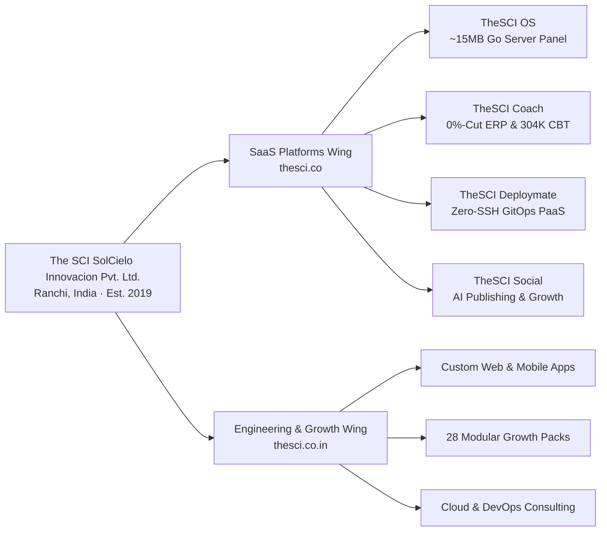

  

  
  
  
  
  

  
  
  
  
  

---

### Who We Are

**The SCI SolCielo Innovacion Private Limited™ (TheSCI)** is a systems-engineering, B2B SaaS, and digital growth technology company headquartered in **Ranchi, Jharkhand, India** (serving businesses since **2019** · formally incorporated as an MCA Private Limited company in **February 2026**).

We build **bare-metal-fast, sovereign software platforms** that dismantle bloated per-seat SaaS taxes and 15% EdTech aggregator commissions — operating across two specialized digital wings:

-  **Product Platforms Wing — [`https://thesci.co`](https://thesci.co):** Four production-ready SaaS & self-hosted systems engineered in Go, TypeScript, Next.js, and PostgreSQL.
-  **Client Engineering & Digital Growth Wing — [`https://thesci.co.in`](https://thesci.co.in):** Full-stack custom websites, Android/iOS mobile apps, enterprise software, cloud/DevOps migrations, and 28 plain-English digital marketing growth modules.

---

### Our 4 Flagship Production Engines ([`thesci.co`](https://thesci.co))

<table>
  <tr>
    <td width="50%" valign="top">
      <h3> &nbsp;01. TheSCI OS</h3>
      
<strong>Compiled Cloud Server Operating System</strong> 
      <a href="https://thesci.co/platform"><code>thesci.co/platform</code></a> · <em>Replaces cPanel, Plesk, CyberPanel</em>

      <ul>
        <li>Single compiled <strong>Go + Fiber v2</strong> binary idling at <strong>~15MB RAM</strong></li>
        <li>Unifies <strong>Caddy 2 HTTP/3</strong> (auto-SSL), <strong>PowerDNS SQL</strong>, <strong>Postfix/Dovecot</strong> mail &amp; <strong>MariaDB</strong></li>
        <li><strong>17 modular infrastructure services</strong> with zero per-account licensing tax</li>
      </ul>
    </td>
    <td width="50%" valign="top">
      <h3> &nbsp;02. TheSCI Coach</h3>
      
<strong>White-Label Coaching ERP &amp; 304K+ CBT Exam Studio</strong> 
      <a href="https://coach.thesci.co"><code>coach.thesci.co</code></a> · <em>Replaces Classplus, Teachmint, Graphy</em>

      <ul>
        <li><strong>0% fee commission</strong> — institutes keep 100% of student tuition revenue</li>
        <li><strong>304,000+ curated questions</strong> &amp; Live NTA-pattern CBT simulator (JEE, NEET, UPSC, Boards)</li>
        <li>Full 8-module institute ERP starting at <strong>₹11,999/yr</strong> (Question Studio) &amp; <strong>₹84,000/yr</strong> (Full ERP)</li>
      </ul>
    </td>
  </tr>
  <tr>
    <td width="50%" valign="top">
      <h3> &nbsp;03. TheSCI Deploymate</h3>
      
<strong>Zero-SSH Self-Hosted GitOps PaaS</strong> 
      <a href="https://deploy.thesci.co"><code>deploy.thesci.co</code></a> · <em>Replaces Vercel, Heroku, Render</em>

      <ul>
        <li>Push-to-deploy GitOps CI/CD directly on your own VPS or bare-metal servers</li>
        <li>Automated preview environments, zero-downtime rollouts &amp; instant rollbacks</li>
        <li>Zero vendor lock-in and zero bandwidth-overage bills</li>
      </ul>
    </td>
    <td width="50%" valign="top">
      <h3> &nbsp;04. TheSCI Social</h3>
      
<strong>Omnichannel AI Social &amp; Digital Growth Hub</strong> 
      <a href="https://social.thesci.co"><code>social.thesci.co</code></a> · <em>Replaces Hootsuite, Buffer, Sprout Social</em>

      <ul>
        <li>Multi-platform scheduling, AI-assisted content pipelines &amp; unified analytics</li>
        <li>Powers our <strong>28 Plug-and-Play Growth Modules</strong> for coaching centres &amp; SMBs</li>
        <li>Transparent flat plans starting at <strong>₹5,000/mo</strong> (capped at ₹8,000/mo across 5+ apps)</li>
      </ul>
    </td>
  </tr>
</table>

---

### Custom Engineering & Digital Growth Studio ([`thesci.co.in`](https://thesci.co.in))

Beyond our flagship SaaS platforms, our engineering & creative teams partner directly with founders, coaching institutes, clinics, and enterprises across **Jharkhand, Bihar, Odisha, Uttar Pradesh, West Bengal, and globally**:

| Capability | What We Deliver | Portal |
| :--- | :--- | :--- |
| **Custom Web & SaaS Engineering** | SEO/GEO-engineered Next.js, React, Go & PostgreSQL web platforms built for 95+ Core Web Vitals | [`thesci.co.in`](https://thesci.co.in) |
| **Mobile App Development** | Native Android, iOS & cross-platform (Flutter / React Native) student, customer & enterprise apps | [`thesci.co.in`](https://thesci.co.in) |
| **Cloud Infrastructure & Migrations** | Bare-metal VPS setup, cPanel → TheSCI OS migration, zero-downtime cloud DevOps & RLS security audits | [`thesci.co/services`](https://thesci.co/services) |
| **28 Digital Growth Modules** | Social Post Studio, Local Google Maps SEO, AI Search (`GEO`/`LLMO`), Reels & Video Production, Meta/Google Lead Ads | [`thesci.co/pricing`](https://thesci.co/pricing) |

---

### Dual-Domain Ecosystem Architecture

---

### Core Technology Stack

  
  
  
  
  
  
  
  
  
  

### Engineering Principles
1. **Compiled Speed First** — Eliminate memory bloat so lean VPS hardware performs like enterprise clusters.
2. **100% Data Sovereignty** — Zero vendor lock-in; clients own their domains, student rosters, and databases outright.
3. **Zero Per-Seat & Commission Taxes** — Transparent, predictable flat pricing designed to reward growth rather than penalize it.

---

### Connect & Corporate Credentials

- **Main Product Hub:** [https://thesci.co](https://thesci.co) · **Transparent INR Pricing:** [https://thesci.co/pricing](https://thesci.co/pricing)
- **Client Engineering & Growth Portal:** [https://thesci.co.in](https://thesci.co.in)
- **Official Support & Partnerships:** `support@thesci.co.in`
- **Founder & Chief Architect:** [Shivam Vishwanaath](https://shivamvishwanaath.dev)
- **Corporate Registration:** The SCI SolCielo Innovacion Private Limited™ · `CIN: U62011JH2025PTC025797` · `GSTIN: 20AAMCT8016E1ZL` · Kokar Chowk, Ranchi, Jharkhand 834001, India

  © The SCI SolCielo Innovacion Private Limited™ · Building Sovereign Cloud, EdTech &amp; Growth Infrastructure from East India for the World.

